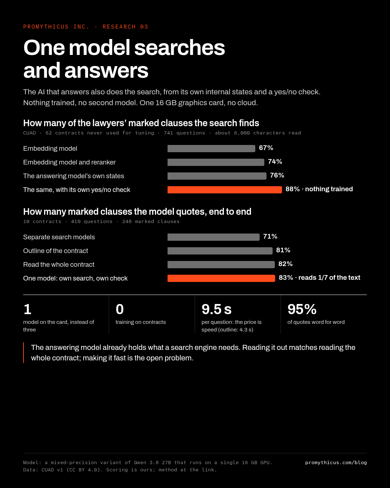

# One model that searches and answers

**Promythicus Tech research.** Write-up for a general reader: [promythicus.com/blog/one-ai-model-searches-and-answers-contracts/](https://promythicus.com/blog/one-ai-model-searches-and-answers-contracts/)

**Question.** A private AI server usually runs an answering model plus an embedding model and a reranker, all
competing for one graphics card. Can the answering model do the search itself, with nothing trained?

**Answer.** Yes. Its own internal states, read at a middle layer, find 76% of the clauses lawyers marked in CUAD; its
own yes/no check on the 30 best passages raises that to 88%. End to end it quotes 83% of the clauses, level with
reading the whole contract (82%), while reading a seventh of the text. The price is speed.

## Results

Search only: 62 CUAD test contracts never used for tuning, 741 questions, share of marked clauses inside the 12
passages read (about 6,000 characters).

| Search | Fitted on contracts? | Clauses found |
| ------ | -------------------- | ------------- |
| Qwen3-8B with the released CLM-v0.1-8B head | no | 29% |
| Qwen3-Embedding-0.6B | no | 67% |
| The same with Qwen3-Reranker-0.6B | no | 74% |
| The answering model's own states (layer 36 of 64, mean over the passage's tokens) | no | 76% |
| The same, then its own yes/no on the 30 best passages | no | **88%** |
| Embedding model with a closed-form add-on fitted on 40 practice contracts | yes | 88% |

The fitted add-on does not carry to new questions: fitted on half of CUAD's 41 kinds of question, it scores 90% on
the kinds it saw and 74% on the kinds it did not (71% without it). We dropped it.

End to end: 10 contracts, 410 questions, 248 marked clauses, same prompt and scoring as
[cuad-retrieval](https://github.com/Promythicus/cuad-retrieval) and
[outline-routing](https://github.com/Promythicus/outline-routing).

| Way of reading | Clauses quoted | Seconds a question |
| -------------- | -------------- | ------------------ |
| Separate search models, 12 passages | 71% | 3.1 |
| Own states, 12 passages | 73% | 3.0 |
| Outline, 4 parts | 81% | 4.3 |
| Whole contract | 82% | 3.3 (8.3 for the first question) |
| Own states and own yes/no, 12 passages | **83%** | 9.5 |
| Own states and own yes/no, 24 passages | 70% | 10.0 |

With 248 clauses, 81 to 83% are level. Reading 24 scattered passages is worse than reading 12.

## Speed, so far

The yes/no check is the slow part: about 0.2 s a passage on a 16 GB card. Sending the 30 passages together, with 1 to
8 server slots, changed nothing (8.6 s a question); turning off the server's RAM prompt cache gave 5.9 s; a shorter
prompt gave 5.5 s and cost two points (85.7% against 87.5%). Checking 20 passages instead of 30 gives 84.8%. Keeping
each passage's state from intake, so that only the question is new work, is untried.

## How

- `search/own27.py`: the model's state for each passage and question (through `tools/probe.cpp`, which reads a GGUF
  model's internal states via llama.cpp); the layer is chosen on 40 practice contracts, then used once on the other 62.
- `search/rr27.py`: the yes/no check. The passage comes first in the prompt and the question last; the score is
  log P(yes) - log P(no) at the first answer token. Also the speed tests.
- `search/e2e27.py`: search, check and answer with the one model.
- `search/head.py`, `search/rr.py`: the fitted add-ons and the check on unseen kinds of question. `search/clm.py`: the
  released CLM head.
- `search/README.md` has the full table and limits. The scripts import `retr.py` and `bench.py` from
  [cuad-retrieval](https://github.com/Promythicus/cuad-retrieval): clone it beside this repository.

## Limits

One dataset (American commercial contracts in English, short enough to fit in the model's memory). Scoring is ours.
The CLM head was run in 8-bit and its prompt format was not confirmed, so 29% may understate it. The yes/no check
costs about 0.2 s a passage on a 16 GB card; running the checks in parallel did not help. One run of each method.

## Running it

- Everything ran on one workstation with one 16 GB NVIDIA graphics card and no cloud service.
- The larger model is named only as **a mixed-precision variant of Qwen 3.8 27B that runs on a single 16 GB GPU**. Scripts take its file from the environment:
  `export MODEL_GGUF=/path/to/your/model.gguf`. The small models are the public releases.
- Datasets and models are not in this repository; the write-up says where they come from.
- Large raw outputs (model states, patches) are left out; the scripts regenerate them.

## Licence

Code and write-ups: Apache-2.0, copyright 2026 Promythicus Tech Inc. Result files that quote dataset text keep the
dataset's licence (CUAD: CC BY 4.0, The Atticus Project).

One run of each, our own scoring: these numbers cannot be set beside published benchmarks. Corrections are welcome:
root@promythicus.com. More experiments: [github.com/Promythicus](https://github.com/Promythicus) ·
[promythicus.com/blog](https://promythicus.com/blog/)
